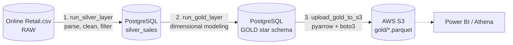
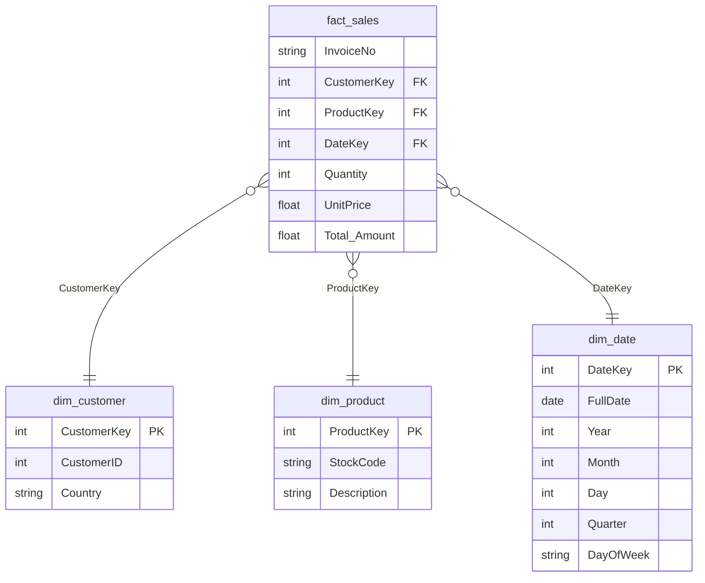
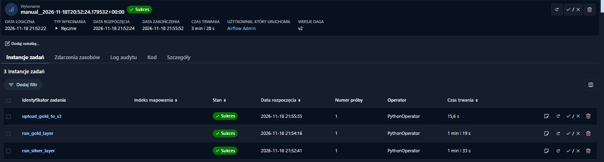
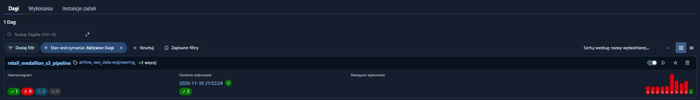
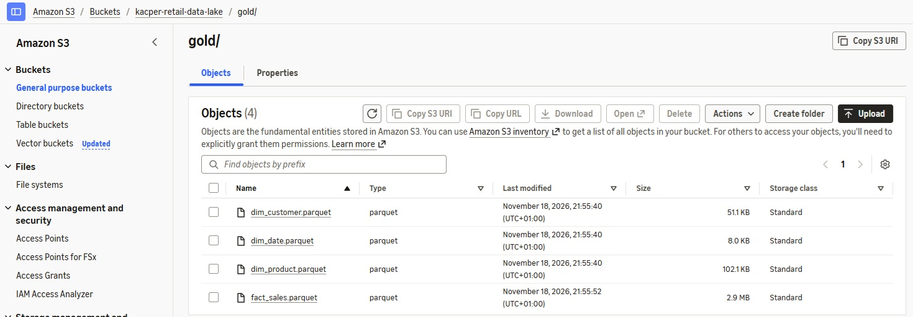
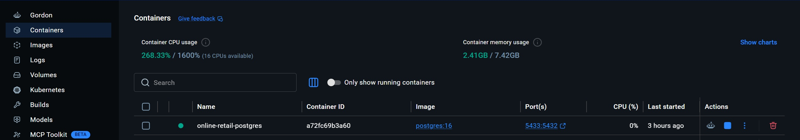

# Retail Data Engineering Pipeline: Medallion Architecture + Airflow + AWS S3

🇬🇧 English | 🇵🇱 [Polski](README.pl.md)

End-to-end ETL pipeline that turns a raw, messy retail export (541,909 rows of CSV in a Polish locale) into a clean **star schema** in PostgreSQL and publishes it as **Parquet files in an AWS S3 data lake**. Orchestrated with **Apache Airflow** running in **Docker**.

    

## Architecture



All three steps are tasks of one Airflow DAG: `retail_medallion_s3_pipeline`.

| Layer | Where | What happens |
|-------|-------|--------------|
| **Raw** | `dags/Online Retail.csv` | Untouched source file (not stored in git) |
| **Silver** | PostgreSQL `silver_sales` | Types fixed, Polish formats parsed, returns and bad rows removed, `total_amount` computed |
| **Gold** | PostgreSQL `dim_*`, `fact_sales` | Star schema with surrogate keys, ready for BI |
| **Export** | S3 `gold/*.parquet` | Columnar, compressed copy of the Gold tables (storage/compute separation) |

## Star schema (Gold layer)



## Results (on the full dataset)

| Stage | Rows |
|-------|-----:|
| Raw CSV | 541,909 |
| Silver (after cleaning) | 530,104 |
| `fact_sales` | 530,104 |
| `dim_customer` / `dim_product` / `dim_date` | 4,355 / 3,922 / 305 |

The pipeline fails fast if the Gold layer is inconsistent: assertions check that the fact table keeps the same row count as Silver and that no foreign key is `NULL`.

## Data engineering challenges solved

The source file was exported from a Polish version of Excel, which caused a chain of problems. Details are in [docs/TROUBLESHOOTING.md](docs/TROUBLESHOOTING.md).

- **Polish CSV locale**: `;` separator, decimal comma (`2,55`), dates as `dd.mm.yyyy hh:mm`, `latin1` encoding. Handled with explicit `decimal=","`, `sep=";"` and a strict date `format=`.
- **Inconsistent product data**: the same `StockCode` appears with several descriptions. The product dimension keeps one row per `StockCode` (most frequent description), and the fact table joins on `StockCode` only, so no rows are lost.
- **Guest orders**: 25% of rows have no `CustomerID`; they are mapped to customer `0` instead of being dropped.
- **Dirty transactions**: cancellations (invoices starting with `C`) and rows with non-positive quantity or price are filtered out.
- **Secrets management**: AWS keys and DB credentials come from `.env` (git-ignored), never from code. The S3 task fails with a clear message if credentials are missing.
- **Least-privilege IAM**: a custom policy limited to one bucket is provided in [docs/iam-policy.json](docs/iam-policy.json).

## Tech stack

Python, pandas, SQLAlchemy, PostgreSQL, Apache Airflow (CeleryExecutor), Docker Compose, AWS S3, boto3, Parquet (pyarrow), SQL (window functions, RFM).

## Repository structure

```
.
├── dags/
│   └── retail_dag.py            # Airflow DAG: Silver -> Gold -> S3
├── sql/
│   ├── analytics_queries.sql    # Trend, top products, RFM, data quality checks
│   └── indexes.sql              # Optional indexes on fact table foreign keys
├── docs/
│   ├── TROUBLESHOOTING.md       # Real problems met during the project and fixes
│   ├── iam-policy.json          # Least-privilege S3 policy
│   └── images/                  # Screenshots used in this README
├── docker-compose.yaml          # Airflow (official compose, CeleryExecutor)
├── .env.example                 # Template for secrets and configuration
├── requirements.txt
├── README.md
└── README.pl.md             # Polish version
```

## How to run

### Prerequisites

- Docker Desktop (4+ GB RAM for Docker)
- A PostgreSQL instance reachable from Docker. In this project it runs on the **host machine**, port `5433`, with an empty database `online_retail_db`. Containers reach it through `host.docker.internal`.
- An AWS account, an S3 bucket in your region (default `eu-north-1`) and an IAM user restricted to that bucket ([docs/iam-policy.json](docs/iam-policy.json)).

### Steps

```bash
# 1. Clone
git clone https://github.com/KacperGrzeszyk/retail-medallion-pipeline.git
cd retail-medallion-pipeline

# 2. Configure secrets (never commit .env)
cp .env.example .env        # Windows PowerShell: Copy-Item .env.example .env
# edit .env: FERNET_KEY, AWS keys, bucket name, DB settings

# 3. Download the dataset (see "Dataset") and put the CSV in dags/
#    -> dags/Online Retail.csv

# 4. Start Airflow
docker compose up -d
```

Open <http://localhost:8080> (login `airflow` / password `airflow`), un-pause the DAG **`retail_medallion_s3_pipeline`** and click **Trigger**. After the run, the four Parquet files appear in `s3://<your-bucket>/gold/`.

> After changing `.env`, run `docker compose down && docker compose up -d`. A plain `restart` does not reload environment variables.

### Dataset

[Online Retail](https://archive.ics.uci.edu/dataset/352/online+retail) (UCI Machine Learning Repository), transactions of a UK online gift shop between 01/12/2010 and 09/12/2011.
The pipeline expects the file as `Online Retail.csv` in the Polish Excel format (`;` separator, decimal comma, `dd.mm.yyyy hh:mm` dates). If you export it differently, adjust the `read_csv` / `to_datetime` arguments in `dags/retail_dag.py`.

## Analytics

[sql/analytics_queries.sql](sql/analytics_queries.sql) contains queries on the Gold layer:

1. Monthly revenue with month-over-month growth (`LAG`)
2. Top 10 products by revenue (service codes such as postage excluded)
3. Revenue by country with share of total (`SUM() OVER ()`)
4. Revenue by day of week
5. Top customers
6. **RFM segmentation** (`NTILE`) with customer segments
7. Data quality checks (orphan keys, invalid values)

Sample findings from the data: revenue totals about **£10.67M** over 19,960 invoices; the United Kingdom accounts for roughly **85%** of sales; the best-selling product by revenue is *REGENCY CAKESTAND 3 TIER*.

## Screenshots

**Airflow: successful run of all three tasks**



**Airflow: DAG list**



**S3 data lake: Parquet files in `gold/`**



**PostgreSQL container used as the warehouse (Docker Desktop)**



## Possible improvements

- Incremental loads instead of `if_exists="replace"`
- Data quality framework (Great Expectations) as an extra Airflow task
- Query the S3 Parquet files with Amazon Athena / Glue Catalog
- Power BI dashboard on top of the star schema
- Terraform for the S3 bucket and IAM user

## Author

Kacper Grzeszyk, [GitHub](https://github.com/KacperGrzeszyk)

Licensed under the MIT License.
