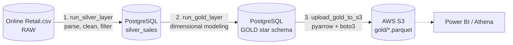
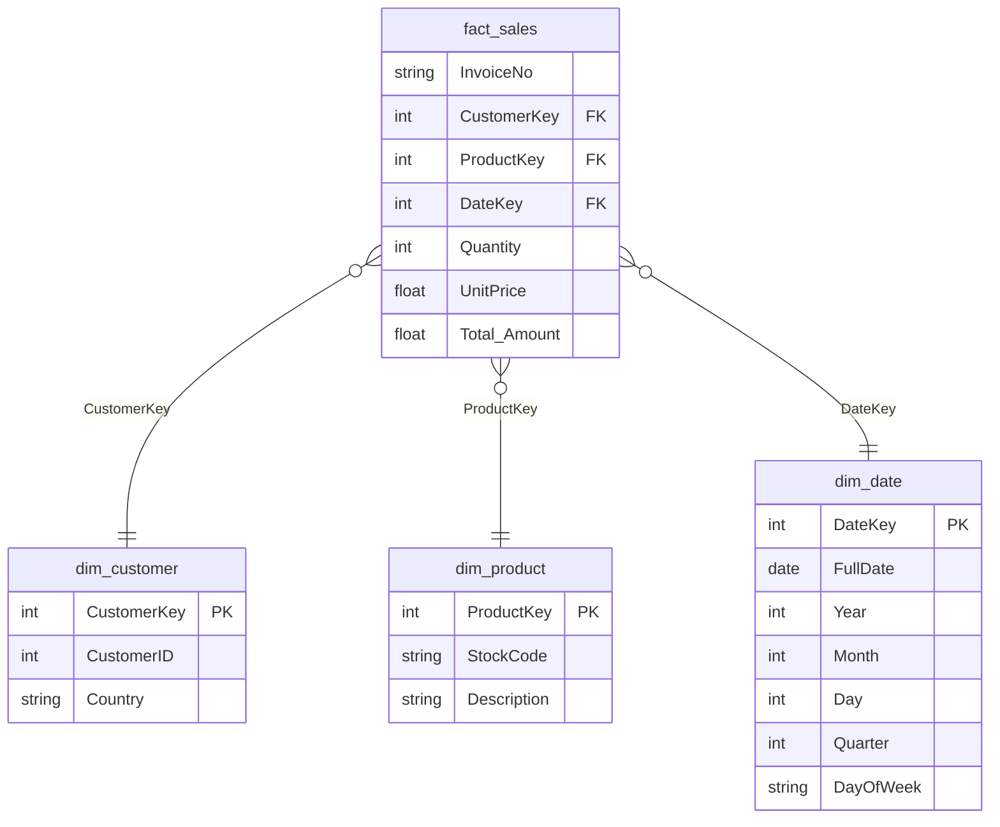
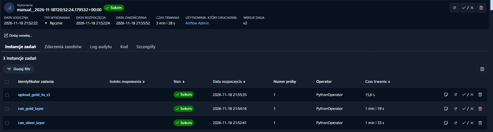
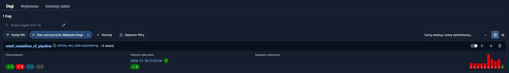
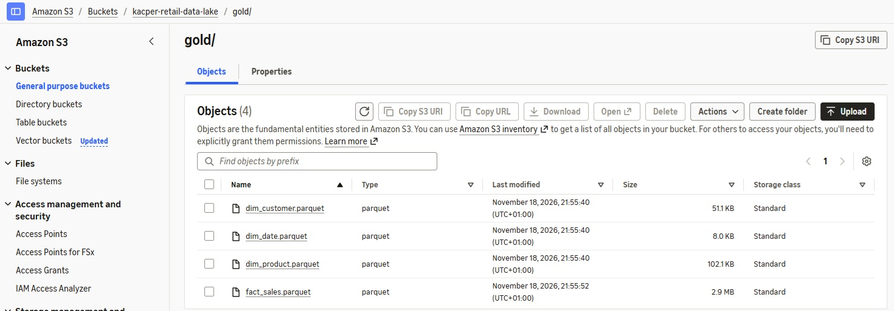
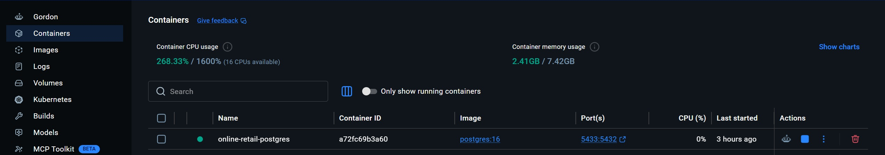

# Pipeline Data Engineering: Medallion Architecture + Airflow + AWS S3

🇬🇧 [English](README.md) | 🇵🇱 Polski

Kompletny pipeline ETL, który zamienia surowy eksport danych sprzedażowych (541 909 wierszy CSV w polskim formacie Excela) w czysty **model gwiazdy** w PostgreSQL i publikuje go jako **pliki Parquet w data lake na AWS S3**. Całość orkiestruje **Apache Airflow** uruchomiony w **Dockerze**.

    

## Architektura



Wszystkie trzy kroki to zadania jednego DAG-a Airflow: `retail_medallion_s3_pipeline`.

| Warstwa | Gdzie | Co się dzieje |
|---------|-------|---------------|
| **Raw** | `dags/Online Retail.csv` | Nietknięty plik źródłowy (nie jest w repozytorium) |
| **Silver** | PostgreSQL `silver_sales` | Poprawione typy, sparsowane polskie formaty, usunięte zwroty i błędne wiersze, wyliczone `total_amount` |
| **Gold** | PostgreSQL `dim_*`, `fact_sales` | Model gwiazdy z kluczami zastępczymi, gotowy pod BI |
| **Eksport** | S3 `gold/*.parquet` | Kolumnowa, skompresowana kopia tabel Gold (rozdzielenie storage i compute) |

## Model gwiazdy (warstwa Gold)



## Wyniki (na pełnym zbiorze)

| Etap | Wiersze |
|------|--------:|
| Surowy CSV | 541 909 |
| Silver (po czyszczeniu) | 530 104 |
| `fact_sales` | 530 104 |
| `dim_customer` / `dim_product` / `dim_date` | 4 355 / 3 922 / 305 |

Pipeline przerywa działanie, gdy warstwa Gold jest niespójna: asercje sprawdzają, że tabela faktów ma tyle samo wierszy co Silver oraz że żaden klucz obcy nie jest `NULL`.

## Rozwiązane problemy inżynierskie

Źródło pochodziło z polskiej wersji Excela, co wywołało łańcuch problemów. Szczegóły w [docs/TROUBLESHOOTING.md](docs/TROUBLESHOOTING.md).

- **Polski format CSV**: separator `;`, przecinek dziesiętny (`2,55`), daty `dd.mm.rrrr hh:mm`, kodowanie `latin1`. Obsłużone przez jawne `decimal=","`, `sep=";"` i ścisły `format=` dla dat.
- **Niespójne dane produktów**: ten sam `StockCode` występuje z kilkoma opisami. Wymiar produktu ma jeden wiersz na `StockCode` (najczęstszy opis), a fakty łączą się tylko po `StockCode`, więc żaden wiersz nie ginie.
- **Zamówienia gości**: 25% wierszy nie ma `CustomerID`. Zamiast je usuwać, mapuję je na klienta `0`.
- **Brudne transakcje**: anulowania (faktury zaczynające się na `C`) oraz wiersze z ilością lub ceną ≤ 0 są odfiltrowywane.
- **Zarządzanie sekretami**: klucze AWS i dane do bazy pochodzą z `.env` (ignorowany przez git), nigdy z kodu. Task S3 kończy się czytelnym komunikatem, gdy brakuje kluczy.
- **Zasada najmniejszych uprawnień**: własna polityka IAM ograniczona do jednego bucketu w [docs/iam-policy.json](docs/iam-policy.json).

## Stack technologiczny

Python, pandas, SQLAlchemy, PostgreSQL, Apache Airflow (CeleryExecutor), Docker Compose, AWS S3, boto3, Parquet (pyarrow), SQL (funkcje okna, RFM).

## Struktura repozytorium

```
.
├── dags/
│   └── retail_dag.py            # DAG Airflow: Silver -> Gold -> S3
├── sql/
│   ├── analytics_queries.sql    # Trend, top produkty, RFM, testy jakości danych
│   └── indexes.sql              # Opcjonalne indeksy na kluczach obcych faktów
├── docs/
│   ├── TROUBLESHOOTING.md       # Prawdziwe problemy z projektu i ich rozwiązania
│   ├── iam-policy.json          # Polityka S3 o najmniejszych uprawnieniach
│   └── images/                  # Zrzuty ekranu używane w README
├── docker-compose.yaml          # Airflow (oficjalny compose, CeleryExecutor)
├── .env.example                 # Szablon sekretów i konfiguracji
├── requirements.txt
├── README.md                    # English version
└── README.pl.md
```

## Jak uruchomić

### Wymagania

- Docker Desktop (min. 4 GB RAM dla Dockera)
- PostgreSQL dostępny z Dockera. W tym projekcie działa na **maszynie hosta**, port `5433`, z pustą bazą `online_retail_db`. Kontenery łączą się przez `host.docker.internal`.
- Konto AWS, bucket S3 w Twoim regionie (domyślnie `eu-north-1`) i użytkownik IAM ograniczony do tego bucketu ([docs/iam-policy.json](docs/iam-policy.json)).

### Kroki

```bash
# 1. Sklonuj repozytorium
git clone https://github.com/KacperGrzeszyk/retail-medallion-pipeline.git
cd retail-medallion-pipeline

# 2. Skonfiguruj sekrety (nigdy nie commituj .env)
cp .env.example .env        # PowerShell: Copy-Item .env.example .env
# uzupełnij .env: FERNET_KEY, klucze AWS, nazwa bucketu, ustawienia bazy

# 3. Pobierz zbiór danych (patrz "Dane") i wrzuć CSV do dags/
#    -> dags/Online Retail.csv

# 4. Uruchom Airflow
docker compose up -d
```

Wejdź na <http://localhost:8080> (login `airflow`, hasło `airflow`), włącz DAG **`retail_medallion_s3_pipeline`** i kliknij **Trigger**. Po zakończeniu cztery pliki Parquet pojawią się w `s3://<twój-bucket>/gold/`.

> Po zmianie `.env` wykonaj `docker compose down && docker compose up -d`. Zwykły `restart` nie wczytuje zmiennych środowiskowych na nowo.

### Dane

[Online Retail](https://archive.ics.uci.edu/dataset/352/online+retail) (UCI Machine Learning Repository), transakcje brytyjskiego sklepu internetowego z prezentami od 01.12.2010 do 09.12.2011.
Pipeline oczekuje pliku `Online Retail.csv` w polskim formacie Excela (separator `;`, przecinek dziesiętny, daty `dd.mm.rrrr hh:mm`). Jeśli wyeksportujesz plik inaczej, dostosuj argumenty `read_csv` i `to_datetime` w `dags/retail_dag.py`.

## Analityka

[sql/analytics_queries.sql](sql/analytics_queries.sql) zawiera zapytania na warstwie Gold:

1. Miesięczny przychód ze wzrostem m/m (`LAG`)
2. Top 10 produktów wg przychodu (bez kodów usługowych, np. przesyłki)
3. Przychód wg kraju z udziałem w całości (`SUM() OVER ()`)
4. Przychód wg dnia tygodnia
5. Najwięksi klienci
6. **Segmentacja RFM** (`NTILE`) z segmentami klientów
7. Testy jakości danych (osierocone klucze, niepoprawne wartości)

Przykładowe wnioski: przychód ok. **10,67 mln £** z 19 960 faktur, Wielka Brytania to około **85%** sprzedaży, a najlepiej sprzedającym się produktem wg przychodu jest *REGENCY CAKESTAND 3 TIER*.

## Zrzuty ekranu

**Airflow: udane wykonanie wszystkich trzech tasków**



**Airflow: lista DAG-ów**



**Data lake na S3: pliki Parquet w `gold/`**



**Kontener PostgreSQL jako hurtownia danych (Docker Desktop)**



## Możliwe usprawnienia

- Ładowanie przyrostowe zamiast `if_exists="replace"`
- Framework jakości danych (Great Expectations) jako dodatkowy task
- Zapytania do plików Parquet na S3 przez Amazon Athena / Glue Catalog
- Dashboard Power BI na modelu gwiazdy
- Terraform dla bucketu S3 i użytkownika IAM

## Autor

Kacper Grzeszyk, [GitHub](https://github.com/KacperGrzeszyk)

Licencja MIT.
